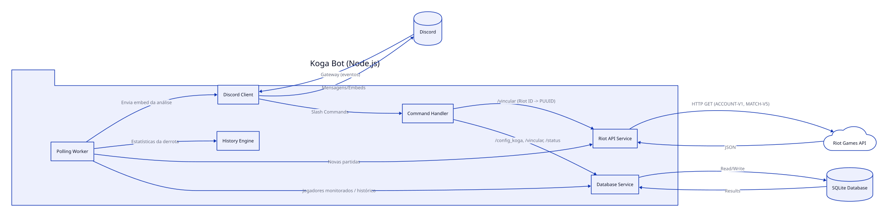
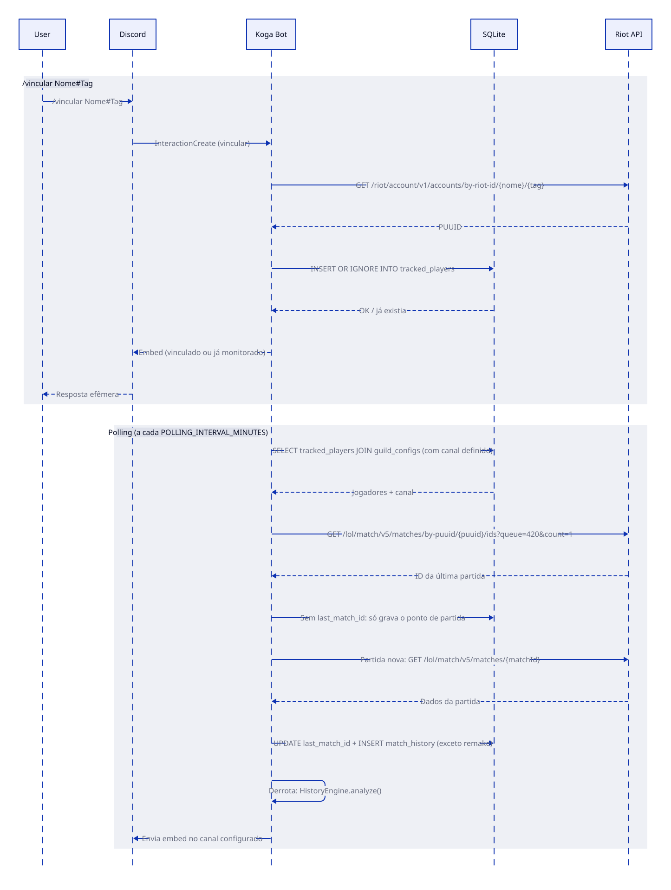
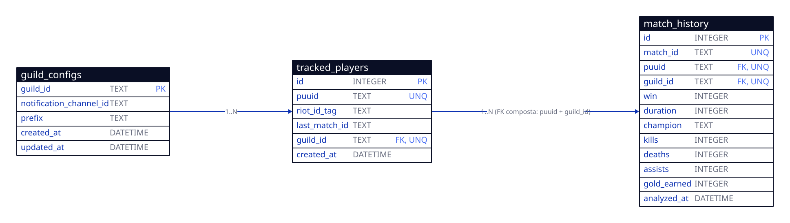

# Discord Bot Koga - Documentação de Arquitetura e Regras de Negócio

## 1. Visão Geral do Sistema

O **Discord Bot Koga** é uma aplicação Node.js desenvolvida para monitorar o desempenho de jogadores de League of Legends. O diferencial do sistema é sua abordagem narrativa: em vez de apenas reportar estatísticas, o bot atua como um acadêmico erudito e estrategista veterano, comparando as derrotas dos jogadores a grandes desastres históricos ou militares, utilizando um tom de ironia acadêmica.

A arquitetura foi desenhada para suportar múltiplos servidores (multi-tenant) de forma isolada, utilizando SQLite para persistência leve e eficiente, e integrando-se à Riot Games API para coleta de telemetria de partidas.

## 2. Arquitetura da Plataforma

O sistema segue uma arquitetura modular baseada em serviços, com os seguintes componentes principais:

*   **Discord Client:** Interface de comunicação com a API do Discord, responsável por receber comandos e enviar mensagens.
*   **Command Handler:** Módulo de roteamento que processa os Slash Commands (`/config_koga`, `/vincular`, `/status`).
*   **Polling Worker:** Serviço em background (agendado via `node-cron`) que verifica periodicamente novas partidas dos jogadores monitorados.
*   **Riot API Service:** Módulo de integração isolado responsável por todas as chamadas à Riot Games API (ACCOUNT-V1 e MATCH-V5), incluindo tratamento de *rate limits* e erros (403, 404, 429).
*   **History Engine:** O "Core Engine" narrativo do bot. Processa estatísticas brutas e seleciona a analogia histórica mais adequada.
*   **Database Service:** Camada de abstração de dados utilizando `better-sqlite3` para operações síncronas e de alta performance.

### 2.1. Diagramas de Arquitetura

**Visão Geral da Arquitetura:**

**Fluxo de Execução (Sequência):**

**Modelo de Dados (Entidade-Relacionamento):**

## 3. Regras de Negócio

### 3.1. Multi-tenancy e Isolamento

O bot deve operar em múltiplos servidores do Discord simultaneamente, garantindo que os dados de um servidor não interfiram em outro.

*   **Configuração por Servidor:** Cada servidor (Guild) deve configurar um canal específico para notificações através do comando `/config_koga`.
*   **Monitoramento Isolado:** O comando `/vincular` associa um jogador (Riot ID) ao servidor onde o comando foi executado. Um mesmo jogador pode ser monitorado em múltiplos servidores, mas as notificações serão enviadas de acordo com a configuração de cada um.

### 3.2. Integração com Riot Games API

A comunicação com a Riot API é crítica e deve ser gerenciada cuidadosamente para evitar bloqueios.

*   **Tradução de Identidade:** O Riot ID (Nome#Tag) fornecido pelo usuário deve ser convertido em um `PUUID` através do endpoint `ACCOUNT-V1`. O `PUUID` é a chave primária imutável usada para todas as consultas subsequentes.
*   **Telemetria de Partidas:** O endpoint `MATCH-V5` é utilizado para buscar a partida mais recente e seus detalhes estatísticos. Apenas partidas **ranqueadas Solo/Duo** (`queue=420`) são consideradas.
*   **Ponto de Partida:** Na primeira verificação de um jogador recém-vinculado, o bot apenas grava a partida mais recente como `last_match_id`, sem analisá-la. Assim, derrotas antigas não são comentadas.
*   **Remakes:** Partidas encerradas por rendição antecipada (`gameEndedInEarlySurrender`) são ignoradas: não geram análise nem entram no histórico.
*   **Apenas Derrotas:** Vitórias são gravadas em `match_history`, mas só derrotas geram mensagem no canal.
*   **Gerenciamento de Rate Limit:** O *Polling Worker* deve implementar um *delay* entre as requisições (padrão: 1.500ms) ao iterar sobre a lista de jogadores, garantindo que os limites da API Key não sejam excedidos.
*   **Tratamento de Erros:**
    *   `404 - Player Not Found`: Deve informar ao usuário que o Riot ID é inválido.
    *   `403 - Key Expired`: O sistema loga o erro criticamente, interrompe o ciclo atual e suspende o polling. Para retomar, é preciso atualizar `RIOT_API_KEY` e reiniciar o bot.
    *   `429 - Rate Limit`: O sistema loga o aviso, encerra o ciclo atual e retoma no próximo ciclo de polling. No `/vincular`, o usuário é avisado para tentar de novo.

### 3.3. O Core Engine: HistoryEngine

O `HistoryEngine` é responsável por transformar dados estatísticos em narrativas irônicas. A categoria da analogia é escolhida com base em duas métricas: a duração da partida e o número de mortes. KDA e ouro acumulado aparecem na mensagem, mas não influenciam a escolha.

As condições são avaliadas nesta ordem, e vale a primeira que for verdadeira. Dentro da categoria, o evento histórico e a frase final são sorteados:

| Condição da Partida | Métrica Principal | Analogia Histórica Sugerida | Tom da Mensagem |
| :--- | :--- | :--- | :--- |
| **Stomp Rápido** | Duração < 20 min | Rendição súbita, colapso precoce (ex: Guerra Anglo-Zanzibari, Capitulação de Detroit) | "Deplorável execução", "Colapso estrutural precoce" |
| **Jogo Longo e Perdido** | Duração > 45 min | Guerra de atrito exaustiva e inútil (ex: Campanha de Galípoli, Guerra dos Oitenta Anos) | "Anacronismo estratégico", "Desperdício de recursos" |
| **Muitas Mortes (Feed)** | Mortes > 10 (e duração entre 20 e 45 min) | Táticas de "carne de canhão", falta de preparo (ex: Batalha de Passchendaele) | "Estratagema pífio", "Sacrifício sem propósito" |
| **Derrota Padrão** | Nenhuma das acima | Queda de impérios, erros táticos gerais (ex: Batalha de Carrhae, Linha Maginot) | "Inevitabilidade histórica", "Falha de comando" |

### 3.4. Personalidade e Tom de Voz (O Fator Koga)

Todas as mensagens geradas pelo bot devem aderir estritamente à persona de Koga:

*   **Perfil:** Acadêmico erudito, Dungeon Master veterano, analista de estratégia.
*   **Atitude:** Observa o fracasso com um "sorriso de canto de boca". Não é agressivo, mas passivo-agressivo e intelectualmente superior.
*   **Vocabulário Característico:** "anacronismo estratégico", "deplorável execução", "estratagema pífio", "inevitabilidade histórica".
*   **Estrutura da Mensagem:**
    1.  **Identificação:** Referência ao jogador e ao campeão utilizado.
    2.  **Analogia:** A comparação histórica baseada nos dados.
    3.  **Conclusão (Rage Bait):** Uma frase final de falso consolo.

## 4. Comandos do Bot

| Comando | Descrição | Permissão Necessária |
| :--- | :--- | :--- |
| `/config_koga` | Define o canal onde o bot enviará as análises de derrotas. | Administrador |
| `/vincular [Nome#Tag]` | Adiciona um jogador à lista de monitoramento do servidor atual. | Qualquer usuário |
| `/status` | Lista todos os jogadores atualmente sendo monitorados no servidor. | Qualquer usuário |

Todos os comandos estão disponíveis apenas em servidores (não em mensagens diretas). Não há comando para remover um jogador do monitoramento.

## 5. Modelo de Dados

### Tabela: `guild_configs`

Armazena a configuração de cada servidor Discord.

| Coluna | Tipo | Descrição |
| :--- | :--- | :--- |
| `guild_id` | TEXT (PK) | ID único do servidor Discord |
| `notification_channel_id` | TEXT | ID do canal de notificações |
| `prefix` | TEXT | Prefixo de comandos (legado) |
| `created_at` | DATETIME | Data de criação |
| `updated_at` | DATETIME | Data da última atualização |

### Tabela: `tracked_players`

Armazena os jogadores monitorados por servidor.

| Coluna | Tipo | Descrição |
| :--- | :--- | :--- |
| `id` | INTEGER (PK) | ID auto-incrementado |
| `puuid` | TEXT | PUUID do jogador (Riot). Único por servidor: `UNIQUE(puuid, guild_id)` |
| `riot_id_tag` | TEXT | Riot ID legível (Nome#Tag) |
| `last_match_id` | TEXT | ID da última partida processada |
| `guild_id` | TEXT (FK) | Referência ao servidor |
| `created_at` | DATETIME | Data de vinculação |

### Tabela: `match_history`

Armazena o histórico de partidas analisadas.

| Coluna | Tipo | Descrição |
| :--- | :--- | :--- |
| `id` | INTEGER (PK) | ID auto-incrementado |
| `match_id` | TEXT | ID da partida (Riot). Único por jogador e servidor: `UNIQUE(match_id, puuid, guild_id)` |
| `puuid` | TEXT (FK) | PUUID do jogador. FK composta `(puuid, guild_id)` → `tracked_players` |
| `guild_id` | TEXT (FK) | ID do servidor |
| `win` | INTEGER | 1 = vitória, 0 = derrota |
| `duration` | INTEGER | Duração em segundos |
| `champion` | TEXT | Nome do campeão |
| `kills` | INTEGER | Abates |
| `deaths` | INTEGER | Mortes |
| `assists` | INTEGER | Assistências |
| `gold_earned` | INTEGER | Ouro acumulado |
| `analyzed_at` | DATETIME | Data da análise |

## 6. Planejamento de Implantação

1.  **Repositório:** `breno-hof/discord-bot-koga` (público).
2.  **Infraestrutura:** Docker + `docker-compose` para conteinerização.
3.  **CI/CD:** GitHub Actions para build da imagem Docker e push para o GHCR (`ghcr.io/breno-hof/discord-bot-koga`).
4.  **Deploy:** Hostinger Docker Manager API ao fazer push na branch `main`.
5.  **Variáveis de Ambiente:** Gerenciamento via `.env` local e GitHub Secrets em produção.
